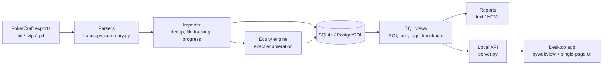

# Architecture

## Modules

| Module | Responsibility |
|---|---|
| `hands.py`, `summary.py` | Regex parsers for GGPoker hand histories and tournament summaries; chip conservation per hand |
| `importer.py` | Classifies files, idempotent loads (natural keys + `ON CONFLICT`), remembers imported files, progress callbacks |
| `equity.py` | Vectorised 7-card evaluator, exact runout enumeration, side pots, all-in detection, parallel precompute |
| `backup.py` | Backup (SQLite online backup into Downloads, dated, never overwritten) and restore (checks the file is ours and not newer, keeps the current database aside, copies in, then upgrades it with the migrations) |
| `export.py` | A hand or a tournament as plain text (positions instead of opponent ids, stacks in BB, every street, result and result by EV; provisional results marked) and CSV for Excel (UTF-8 with BOM; Polish: decimal commas and ';'); files go to Downloads, never overwritten |
| `hand_search.py` | Hand search: `hand_facts` (one row per Hero hand: position, hand type, stack, Hero's first preflop spot and the Analysis v2 counts, all-in, showdown, result and result by EV) rebuilt after each import and by migration 8; `search` runs one parameterised query (fixed SQL per filter, values as parameters). `tools/bench_hand_search.py` checks 500k synthetic hands answer in under 1 s |
| `summary.py` (multi-day) | Prize split into cash and ticket face value; `stage`, `advanced_to`; `importer.refresh_stages` sets `event_id`: every flight that went through joins its later day in `tournament_results`. A later day without a summary takes its stage from the name in its hands and is flagged (`summary_missing`); `provisional_prize` (CLI `provisional`) counts until the summary replaces it |
| `places.py` | Final place as a share of the field: top 10% / 15% with a bootstrap interval, and bands for the place chart |
| `tickets.py` | Tickets won in satellites, and the tournament each was probably used in (information only; the cost stays the full buy-in) |
| `classify.py` | Tags from data only: format, stake, field size, level speed, late registration |
| `scope.py`, `scope_review.py` | What is never imported: Sit & Go, PLO/Omaha and other games, non-dollar tournaments, cash games, freerolls ($0 buy-in) and unreadable summaries (whole tournament, remembered in `excluded_tournaments`); a read-only review of what the rules would remove; the player's ignore list shares `excluded_tournaments` (reason `ignored`), and `tournament_files` remembers which files held each tournament so a restored one is read again |
| `sql/schema.sql`, `sql/views.sql` | Portable DDL and analytics views (same SQL on SQLite and PostgreSQL) |
| `migrations.py` | Upgrades an existing database in place on startup (schema version in the database) |
| `replay.py` | Hand replay as server-side snapshots, so poker accounting is tested in Python, not in the UI |
| `tournament_report.py`, `dashboard.py` | Report data + text/HTML rendering |
| `server.py`, `app.py`, `web/index.html` | Local-only HTTP API, background import job, folder watcher, desktop window |
| `i18n.py`, `web/i18n/en.json`, `web/i18n/pl.json` | App texts in English and Polish: one key file per language for the page and the server, plural forms, number formats |

## Decisions

- **Exact equity instead of Monte Carlo.** Luck is the headline number, so it must not carry sampling noise.
  Enumeration plus a suit-canonical cache keeps it affordable; distinct matchups are spread over CPU cores.
- **Everything derived from files.** No payout structures, no manual tagging: the tool has to work for a player
  who will never type anything in. That rules out ICM, which needs payouts.
- **SQLite for players, PostgreSQL optional.** Zero setup for users; the same portable SQL runs on PostgreSQL
  for anyone who wants a server (tested in CI).
- **Local web UI in a native window.** One UI for macOS and Windows, reuses the HTML reports, no frontend build
  step. The server binds to 127.0.0.1 and write actions need a per-launch token.
- **Upgrade databases, never rebuild them.** `schema.sql` always describes the latest schema; an older database runs
  the numbered steps in `migrations.py` on startup. A rebuild would throw away the equity cache and require the
  original export files, which PokerCraft only keeps for 90 days.
- **One set of translation files for the page and the server.** Texts the server writes (session summary, leak tips,
  money facts) come from the same `web/i18n/<lang>.json` as the page, in the language the page asks for. Plural forms
  follow the CLDR rules (Polish one/few/many), numbers in Polish use a decimal comma and a non-breaking space between
  thousands. Poker jargon stays in English in every language (see `docs/glossary-pl.md`). The CLI HTML reports stay
  English.
- **Say "unknown" instead of guessing.** Small samples, unknown starting stacks, unknown cards and shared knockouts
  are flagged rather than estimated.

## Testing

`python -m unittest discover -s tests -t .` covers parsers, importer, equity, classification, reports, replay and
the HTTP API. The evaluator is checked against all 2,598,960 five-card hands and an independent reference
evaluator; equities against closed-form outs counts and brute force (including a three-way side pot). CI runs the
suite on Linux, macOS and Windows and the core flow against PostgreSQL 16.
